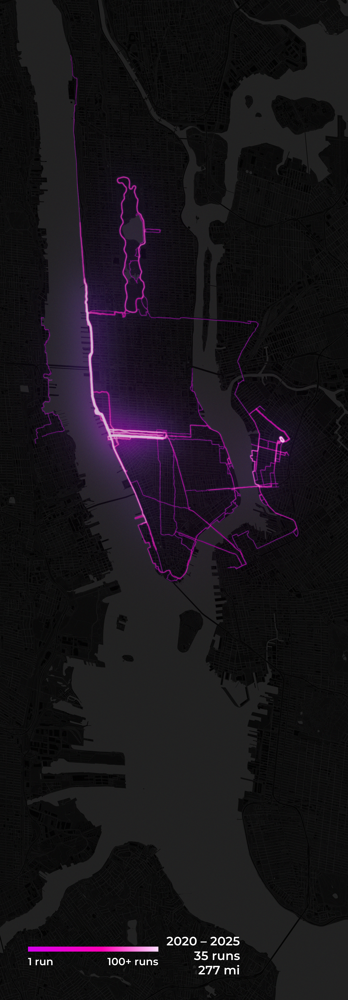
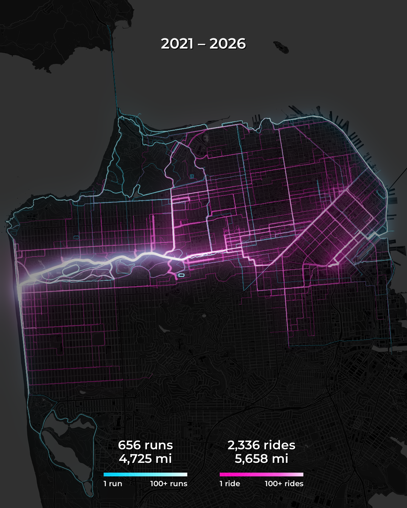

# Strava Heatmap Art

> **Branch `feat/run-bike-combo`** — standalone work that is not meant to merge into
> `main`. It adds a combined runs + Baywheels bike-share map (poster + Instagram-story
> animation). See [Run + bike combo](#run--bike-combo-this-branch) below; everything
> else in this README is the same as `main`.

Generate a print-quality running heatmap poster from your Strava data.


NYC is also pre-configured — optimized to show the full NYC Marathon course (Staten Island → Brooklyn → Queens → Bronx → Manhattan), which one day they will let me run.



---

## Prerequisites

- Python 3.11+
- A [Strava](https://www.strava.com) account with running activities

## Setup

```bash
git clone <this-repo>
cd strava-heatmap-art
python3 -m venv .venv
.venv/bin/pip install -r requirements.txt
cp .env.example .env
source .venv/bin/activate
```

## Strava API setup

1. Go to [strava.com/settings/api](https://www.strava.com/settings/api)
2. Create an application (name and website can be anything)
3. Set **Authorization Callback Domain** to `localhost`
4. Copy your **Client ID** and **Client Secret** into `.env`:
   ```
   STRAVA_CLIENT_ID=12345
   STRAVA_CLIENT_SECRET=abc123...
   ```

## Authenticate

```bash
python auth.py
```

Your browser opens the Strava authorization page. Click **Authorize**. The page redirects to localhost and shows "Auth successful! You can close this tab." — your tokens are saved to `.env` automatically. Come back to the terminal; you'll see:

```
✓ Auth complete. Tokens saved to .env
  Athlete: Kev Ay
  Run: python export.py --fetch
```

## Fetch & render

**First run** — fetch activities and render:
```bash
python export.py --fetch
```

**Subsequent runs** — render from cache (fast):
```bash
python export.py
```

**Quick preview** at 1/10 scale for iteration:
```bash
python export.py --preview
```

**NYC render:**
```bash
python export.py --config nyc
```

Output is saved to `output/poster-<timestamp>.png`.

## Run + bike combo (this branch)

One San Francisco map with two datasets: runs from this repo (cyan) and Lyft Baywheels
bike-share rides (Lyft pink) from the sibling
`baywheels-art` project (checked out next to this repo). Same map, same effects; each dataset
gets its own palette and the two layers are screen-blended together.



**Data:** runs come from `data/activities.json` (fetch them as usual). Rides are read
straight from `../baywheels-art/data/repaired_rides.json` — nothing is copied. Point
somewhere else with `--bikes <path>` or `BIKE_RIDES_PATH` in `combo_config.py`.

### Poster

```bash
python combo_export.py               # full 4720×5900 print render (~6 min)
python combo_export.py --preview     # 1/10 scale
```

Saves `output/poster-combo-<timestamp>.png`.

### Animation (Instagram story)

```bash
python combo_animate.py              # 1080×1350 @ 30fps, 32.5s (~9 min)
python combo_animate.py --preview    # half resolution
python combo_animate.py --still 15   # one frame as a PNG (~1 min) — check before a full run
python combo_animate.py --still 33   # the finished frame
```

Saves `output/animation-combo-<timestamp>.mp4` (or `.png` with `--still`). Timeline:

| Time | What's on screen |
|---|---|
| 0 – 0.5s | Empty map, `0 runs / 0 mi`, `0 rides / 0 mi` |
| 0.5 – 30.5s | Runs and rides draw in date order, paced by activity count (each gets an equal slice of time), each route growing over 0.6s behind a colored dot. Counts and miles tally up; the year range and current month tick along at the top |
| 30.5 – 32.5s | Finished map, final totals, year range only |

Long renders: keep the Mac awake (`caffeinate -i python combo_animate.py`) — a
sleeping machine turned an 8-minute render into 2 hours.

To get it onto your phone, AirDrop the `.mp4` to your iPhone (it lands in Photos) or
import it into Photos on the Mac with iCloud Photos on.

### Tuning (`combo_config.py`)

| Knob | Controls |
|---|---|
| `RUN_COLOR_RAMP` / `BIKE_COLOR_RAMP` | Palettes (cyan / Lyft pink) |
| `RUN_GAMMA`, `BIKE_GAMMA`, `*_HOT_BLOOM_*` | Per-layer brightness and glow — the bike layer is toned down from `baywheels-art` so runs aren't buried |
| `COMBO_CENTER_GAP`, `COMBO_LEGEND_WIDTH_SCALE` | Spacing and width of the two bottom-center stat blocks / legend bars |
| `COMBO_DATE_TOP`, `COMBO_DATE_SCALE`, `COMBO_MONTH_SCALE` | Position and size of the year range / month at the top |
| `COMBO_ANIM_DURATION_S`, `COMBO_ANIM_INTRO_S`, `COMBO_ANIM_HOLD_S` | Build length, blank intro, end hold |
| `COMBO_ANIM_ROUTE_DRAW_S` | How long each route takes to draw (longer = slower, more overlap) |
| `COMBO_ANIM_TRACER_RADIUS`, `COMBO_ANIM_DOT_COLORS`, `COMBO_ANIM_DOT_GLOW_*` | Tracer dots |
| `COMBO_ANIM_RESOLUTION`, `COMBO_ANIM_FPS` | Output size (4:5, matches the poster) and frame rate |

## Adapting for a new city

The recommended approach is to create a `<city>_config.py` that inherits from `config.py` and overrides only the values that differ:

```python
from config import *  # inherit SF defaults

CITY_BOUNDS = {
    "lat_min": 40.575,
    "lat_max": 40.875,
    "lng_min": -74.105,
    "lng_max": -73.730,
}

CANVAS_WIDTH_PX  = 1740   # final output width (after crop)
CANVAS_HEIGHT_PX = 5000   # final output height (after crop)
MAP_TILE_CACHE = "data/map_tile_nyc.png"
```

Then render with:

```bash
python export.py --config nyc
```

NYC comes pre-configured — `nyc_config.py` is included and uses a 29° rotation so Manhattan's street grid runs vertically, with a non-centered crop to frame the borough.

**To configure your own city:**

**1. Geographic bounds** — use [bboxfinder.com](http://bboxfinder.com) to draw your bounding box and set `CITY_BOUNDS`.

**2. Canvas size** — the canvas must match the Mercator aspect ratio of your bounds or the map will be distorted:

```
lng_range_rad  = (lng_max - lng_min) × π/180
merc_max       = arcsinh(tan(lat_max × π/180))
merc_min       = arcsinh(tan(lat_min × π/180))
aspect_ratio   = lng_range_rad / (merc_max - merc_min)   ← width/height
```

Set `CANVAS_WIDTH_PX` and `CANVAS_HEIGHT_PX` so `WIDTH / HEIGHT ≈ aspect_ratio`.

**With rotation** (`CANVAS_ROTATION_DEGREES != 0`): set `CANVAS_RENDER_WIDTH` / `CANVAS_RENDER_HEIGHT` to the intermediate (pre-rotation) canvas dimensions that satisfy the aspect ratio, and set `CANVAS_WIDTH_PX` / `CANVAS_HEIGHT_PX` to your desired final crop size. Use `CANVAS_CROP_X` / `CANVAS_CROP_Y` to shift the crop origin away from center.

**3. Activity filter** — `src/processor.py:filter_sf_runs()` filters by `CITY_BOUNDS` automatically — no code change needed.

## Tweaking visuals

All visual knobs are in `config.py`:

| Variable | What it controls | Safe range |
|---|---|---|
| `GAMMA` | Brightness of rarely-run routes (< 1 lifts dim lines) | 0.3 – 1.0 |
| `ROUTE_LINE_THICKNESS` | Base stroke width in pixels | 1 – 5 |
| `ROUTE_COLOR_RAMP` | Color palette from single-run to peak density | — |
| `HOT_BLOOM_STRENGTH` | Glow intensity on heavily-run corridors | 1.0 – 6.0 |
| `HOT_BLOOM_THRESHOLD` | Density cutoff to trigger hot bloom | 0.5 – 0.9 |
| `MAP_TILE_OPACITY` | How bright the street map shows through | 0.5 – 1.0 |
| `DENSITY_EXPAND_STRENGTH` | How much denser routes appear thicker | 0.5 – 2.0 |
